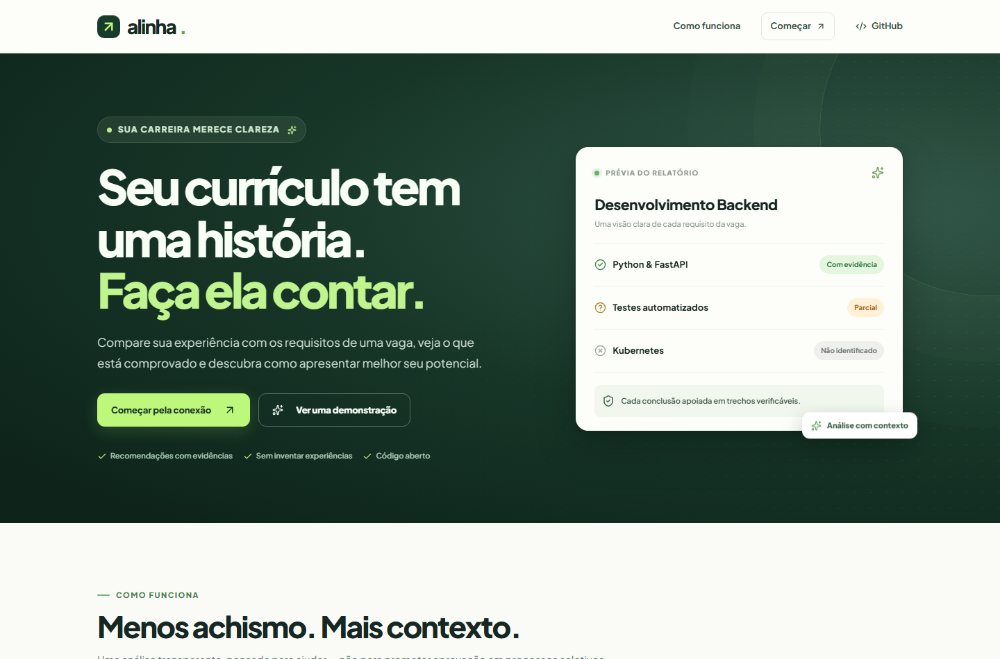

<div align="center">

# alinha.

**Sua experiência, novas oportunidades.**

Compare um currículo com os requisitos de uma vaga. Entenda **o que está comprovado**, **o que está parcialmente demonstrado** e **onde faltam evidências** — sem inventar competências ou prometer aprovação.

[](https://github.com/mxthsu/alinha/actions/workflows/ci.yml)
[](LICENSE)
[](CONTRIBUTING.md)

[**Começar**](docs/getting-started.md) · [**Documentação**](docs/architecture.md) · [**Contribuir**](CONTRIBUTING.md) · [**Roteiro**](docs/roadmap.md)

</div>



## Por que o Alinha?

Descrições de vagas costumam reunir várias competências, experiências e expectativas em um único texto. O Alinha organiza esse conteúdo e compara cada requisito com trechos do currículo, ajudando a pessoa a identificar evidências e melhorar sua apresentação profissional com **informações verdadeiras**.

- **Evidências antes de pontuações:** citações literais da vaga e, quando existirem, do currículo.
- **Requisitos por situação:** com evidência, evidência parcial ou não identificado.
- **Recomendações responsáveis:** sugestões de como explicar melhor o que foi realmente feito.
- **Arquivos e texto:** cole o currículo ou utilize PDF, DOCX ou TXT.
- **Código aberto:** interface, API e verificações podem ser auditadas e executadas localmente.
- **Demonstração sem conta:** explore um resultado explicitamente fictício, sem chamar a IA.

Também incluímos um [currículo e uma vaga inteiramente fictícios](examples/README.md) para testar o formulário sem expor dados pessoais.

O Alinha não simula notas de sistemas ATS, não prevê contratações e não deve ser usado como decisão automática sobre candidatos.

## Experimente no seu computador

**Pré-requisitos:** Python 3.11+, [uv](https://docs.astral.sh/uv/), Node.js 24 e npm.

```bash
git clone https://github.com/mxthsu/alinha.git
cd alinha
python scripts/dev.py
```

O primeiro início instala as dependências necessárias. Abra **http://localhost:3000**: a primeira aba, **Conectar IA**, orienta a escolha e autorização de um provedor. Depois avance para **Analisar currículo**. Sem uma conta ou chave, clique em **Ver uma demonstração** para explorar um relatório fictício. Pressione **Ctrl+C** para parar os serviços.

No Windows, você também pode iniciar com `py -3 scripts/dev.py`. Para instruções manuais, configuração do provedor e solução de problemas, consulte o [guia de instalação](docs/getting-started.md).

**Análises reais:** conecte Gemini, Claude (Anthropic API) ou OpenAI API pela central de conexões do site local. Também há Ollama e o login ChatGPT OAuth no Alinha Community, quando elegíveis. As chaves são verificadas e armazenadas no cofre do sistema operacional, sem persistência no navegador. A demonstração não exige configuração. Consulte [provedores e segurança](docs/providers.md).

## O que acontece durante a análise?

```text
Currículo + descrição da vaga
            |
            v
   Extração e validação
            |
            v
     Provedor de IA
            |
            v
  Requisitos e evidências
            |
            v
Verificação literal de citações
            |
            v
  Relatório com limitações
```

O pipeline utiliza **FastAPI, Pydantic e LangGraph**. A geração por IA e a verificação determinística são etapas separadas: se o modelo citar algo que não aparece no material enviado, a verificação rejeita ou reclassifica a alegação. Isso reduz erros de citação, mas não garante que a interpretação semântica da IA esteja sempre correta.

### Componentes do projeto

| Caminho | Responsabilidade |
| --- | --- |
| [`apps/web`](apps/web) | Site responsivo em Next.js, React e TypeScript |
| [`apps/api`](apps/api) | API Python, extração de documentos e análise |
| [`docs`](docs) | Guias, arquitetura, decisões e roteiro |
| [`scripts`](scripts) | Inicialização simplificada para desenvolvimento |
| [`.github`](.github) | Verificações de qualidade em pull requests |

## Edições e evolução

O **Alinha Community** é software de código aberto sob a licença MIT, projetado para instalação própria. Uma oferta **Alinha Cloud**, com execução hospedada e serviços opcionais, está no planejamento e **não está disponível para contratação**.

Queremos manter o núcleo útil sem assinatura obrigatória. A modalidade hospedada deverá oferecer conveniência operacional, com custos e limites transparentes, sem restringir artificialmente a edição Community. Veja [visão de produto](docs/product-model.md).

| Capacidade | Situação |
| --- | --- |
| Interface pt-BR, arquivos, demonstração fictícia | Disponível no código |
| Gemini, Claude e OpenAI API via chaves pessoais | Implementados; requerem validação real com chave do usuário |
| Login ChatGPT local por OAuth e Ollama | Implementados; aguardam homologação real com conta/modelo |
| Testes automatizados de API e CI | Disponíveis |
| Avaliações sistemáticas e métricas de qualidade | Planejado |
| Alinha Cloud, histórico sincronizado e pagamentos | Planejado; não disponível |

## Privacidade e limites

Na versão inicial, os documentos são processados em memória e **não são salvos pelo Alinha**. Se você habilitar uma análise com provedor externo, o conteúdo será enviado para processamento por esse serviço conforme as condições do próprio provedor. **Não utilize currículos de terceiros sem autorização**.

A extração ainda não suporta OCR de PDFs digitalizados. O resultado não substitui julgamento humano. Confira [segurança](SECURITY.md), [arquitetura](docs/architecture.md) e [roteiro técnico](docs/roadmap.md).

## Comunidade

Relatos de erros, melhorias e contribuições são bem-vindos. Veja [como contribuir](CONTRIBUTING.md) e as [issues](https://github.com/mxthsu/alinha/issues). Utilize somente dados fictícios em testes, exemplos e pull requests.

**Licença:** [MIT](LICENSE).
