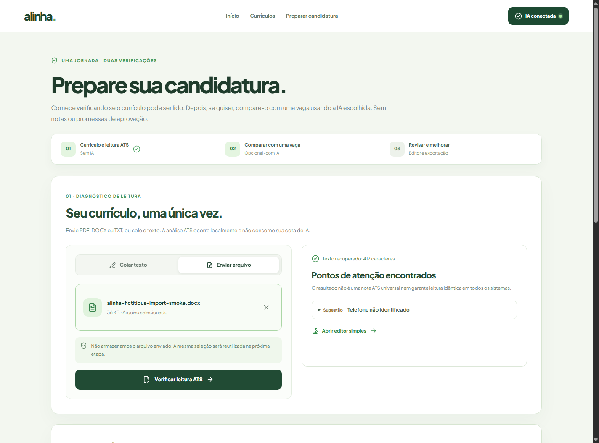

# Preparar candidatura: um fluxo, duas análises

No Alinha Community, a página principal de preparação é **`/preparar`**. As antigas rotas `/ats` e `/analisar` redirecionam para ela.

## Jornada

1. **Currículo, uma única vez.** Envie PDF, DOCX ou TXT (até 3 MB), ou cole texto.
2. **Verificação ATS, sem IA.** O sistema inspeciona texto extraível e sinais de estrutura, apontando possíveis problemas de leitura. Não gera pontuação universal ou promessa de aprovação. A operação não consome tokens de IA.
3. **Comparação com vaga, opcional.** Cole a descrição da oportunidade e selecione um provedor já conectado. O arquivo selecionado na etapa anterior é reutilizado pela interface; o backend extrai seu texto novamente na requisição de comparação, **sem precisar reenviar manualmente**, e realiza uma única análise com o provedor escolhido. Respeita os limites existentes, inclusive o limite do Gemini.
4. **Revisão e exportação.** Ajuste texto no editor simples integrado ou acesse `/studio` para editar campos estruturados e modelos, importando um currículo existente.

## Importação estruturada no Studio

A área **Preencher com meu currículo** aceita PDF, DOCX e TXT e usa o endpoint `POST /api/v1/resumes/structured/import/upload`.

- Reaproveita o leitor de documentos existente (limites de tamanho/páginas, texto selecionável e arquivos em memória).
- Detecta apenas campos explicitamente presentes: nome e dados de contato simples, seções com títulos reconhecidos, linhas de experiência no formato cargo — empresa — período, formação, competências, projetos e idiomas.
- Produz um rascunho no modelo aberto `ResumeProfile` v1, com **texto extraído original**, avisos e **trechos não classificados**.
- **Não preenche automaticamente** o editor: apresenta uma prévia e requer uma confirmação ativa antes de substituir os dados atuais. Depois, os campos podem ser revisados/alterados individualmente.
- Não chama IA, não persiste currículo no servidor e não tenta fazer OCR em PDFs digitalizados.
- Formatos livres que não seguem os títulos/separadores esperados podem exigir edição manual. Importar documentos é uma **sugestão de estrutura**, não uma validação de identidade ou competências.

**Limitação atual:** ao passar de `/preparar` para `/studio`, o arquivo não é persistido nem transportado automaticamente entre páginas. Você poderá selecionar o mesmo arquivo no Studio para preencher os campos; uma futura evolução poderá oferecer uma transição segura em memória entre ferramentas. Dentro de `/preparar`, não há necessidade de selecioná-lo duas vezes.

## Critérios de qualidade

- Nunca inventar experiências, empresas, datas, certificações ou competências.
- Trechos não classificados devem ficar disponíveis ao usuário, não desaparecer silenciosamente.
- A comparação com vaga só deve chamar IA após ação explícita.
- Importação, editor e diagnóstico ATS devem continuar gratuitos e acessíveis sem login e sem conexão de IA.
- Exportar DOCX a partir dos campos confirmados; manter opção JSON aberto para portabilidade.

Veja também [Studio](studio.md), [compatibilidade ATS](ats.md) e [conexões de IA](providers.md).
