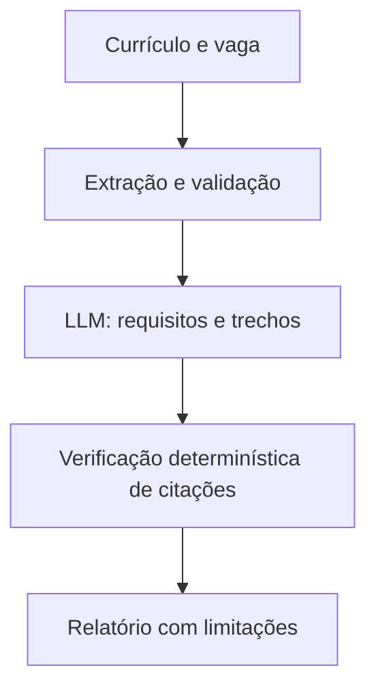

# Arquitetura implementada (referência do código atual)

> **Atenção (22/10/2026):** este texto documenta majoritariamente a stack **atual**, não a arquitetura definitivamente escolhida para o agente. O produto terá Community Open Source (dev), Desktop (app) e Cloud (serviço futuro). O novo núcleo e o executor serão escolhidos por necessidade concreta; não pressupor reescrita em Rust/Go/Python/TypeScript. Leia [guia para novo chat](CONTINUAR-ALINHA.md), [decisão aberta](architecture-evaluation.md) e [contrato neutro](agent-runtime-contract.md).

## Objetivo

Fornecer uma análise de correspondência entre currículo e vaga **fundamentada em evidências literais**, com uma experiência acessível em português e base de código convencional em inglês.

> **Evolução do produto:** a arquitetura desta página documenta o núcleo de análise já funcional. O novo domínio independente de candidaturas está em [contratos do agente](agent-application-contract.md) e [fronteira Community/Pro](open-core-boundaries.md). A política em código ainda não executa ações externas.

### Extensão: descoberta segura de vagas

O primeiro conector está em apps/api/src/alinha_api/agent/discovery.py e a interface em /vagas. A API consulta somente o endpoint HTTPS fixo do Himalayas, valida links, não segue redirecionamentos, limita tempo/tamanho/frequência e não realiza candidaturas. Seu uso depende de Community local; não é proxy público. Contrato do agente: docs/agent-application-contract.md. Auditoria: docs/security-review.md.

## Componentes

- `apps/web`: Next.js, interface client-side, formulário e relatório.
- `apps/api`: FastAPI, contratos Pydantic, leitura limitada de arquivos.
- `services/provider.py`: adaptadores Gemini, Ollama e ChatGPT, cada um usando o contrato `AnalysisProvider`.
- `services/chatgpt_auth.py`: OAuth local de assinatura ChatGPT, validação de ID token, refresh e cofre de credenciais do sistema. A integração permanece desligada em hospedagens não locais.
- `workflows/analysis.py`: LangGraph com nós `generate` e `verify_evidence`.
- `services/model_output.py`: leitura tolerante do JSON do Gemini; remove itens incompletos, limita o tamanho de campos e reclassifica estados desconhecidos conservadoramente, sem inventar citações.
- `services/analysis.py` e `services/evidence_quotes.py`: validação determinística das citações antes de publicar os resultados. Rejeita evidências inexistentes.

## Fluxo

A descrição da vaga e o currículo são **dados não confiáveis**, nunca instruções. O modelo é orientado a citar trechos contínuos e exatos. Se ele parafrasear uma citação da vaga, `services/evidence_quotes.py` pode recuperar **um trecho real da fonte**, apenas quando houver correspondência suficientemente forte e inequívoca com o requisito e a evidência gerada. Caso contrário, o requisito é descartado. Nenhuma chamada extra ao modelo é feita nesse processo. Uma citação atribuída ao currículo que não aparece nele leva o requisito a `nao_identificado`, sem inventar experiência. Se não for possível validar nenhum requisito, a API informa uma falha de citação, em vez de culpar os textos do usuário. Isso **não prova** a correção semântica de cada classificação: avaliações com um conjunto de referência serão adicionadas antes de alegar qualidade medida.

## Decisões e limites

- O fluxo de IA depende do provedor selecionado: chave Gemini, Ollama local ou autorização ChatGPT na instalação local.
- A demonstração local é fixa e marcada como fictícia.
- Provedores são selecionados por solicitação, sem compartilhar credenciais ou alterar o fluxo de verificação.
- Modelos ChatGPT são consultados na conta autenticada, com tokens mantidos apenas no backend local.
- Modelos Gemini/Ollama são configurados localmente por variável de ambiente; as chamadas devem poder ser substituídas por fakes em testes.
- Não há banco, RAG, embeddings, armazenamento de candidatos ou Langfuse **nesta etapa**. Essas tecnologias serão consideradas quando houver caso de uso e requisitos claros.
- As respostas não têm uma porcentagem de compatibilidade ou rótulo de aprovação ATS.
- Máximo de 3 MB por arquivo, 12 páginas PDF, conteúdo DOCX descompactado limitado; não existe OCR.
- O CORS permite, por padrão, `http://localhost:3000`. Ajuste `FRONTEND_ORIGIN` ao publicar.

## Segurança e privacidade

O processamento de documentos ocorre em memória, sem gravação local pelo aplicativo. O Gemini recebe o texto da vaga e o texto do currículo; suas regras de retenção e tratamento são externas ao projeto. Evite logs contendo conteúdo de currículos e não habilite rastreamento de prompts com dados pessoais sem consentimento e política de privacidade apropriada.

Para exposição pública serão necessárias medidas adicionais: limitação de taxa, proteção contra abuso/custo, política de privacidade, consentimento informado, controles de exclusão/retensão, proteção contra uploads maliciosos e observabilidade sem dados sensíveis.

## Avaliações planejadas

Um dataset sintético de vagas e currículos com requisitos anotados será usado para aferir:
1. Precisão na extração de requisitos.
2. Validade das citações da vaga e do currículo.
3. Erros de classificação evidenciado/parcial/não identificado.
4. Latência e custo por análise.

Relatórios de benchmark só serão publicados com dados realmente executados.
