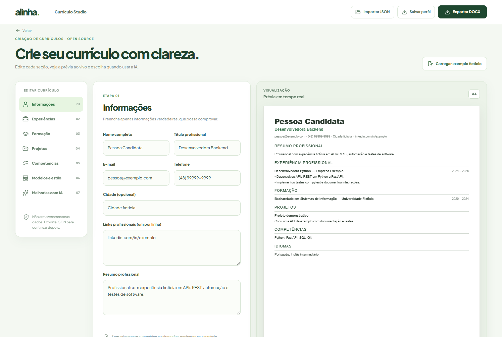

# Currículo Studio

O **Currículo Studio** (rota `/studio`) é o início do criador de currículos estruturados do Alinha Community. Ele segue a identidade do Alinha, com formulário por seções, visualização contínua em A4 e dois modelos de documento.



## Importação assistida de PDF/DOCX/TXT

Clique em **Preencher com meu currículo** para selecionar um documento. O sistema extrai as seções explicitamente reconhecidas, apresenta prévia, avisos e texto não classificado e aguarda uma **confirmação ativa** antes de substituir os campos atuais. Não usa IA nem armazena o arquivo. Formatos livres ou PDFs digitalizados podem exigir digitação manual.

O Studio permanece independente da verificação ATS e da comparação com vagas, que agora ficam unificadas em [Preparar candidatura](application-workflow.md).

## Funcionalidades desta versão

- Informações pessoais, resumo profissional, experiências, formação, projetos, competências e idiomas.
- Prévia em tempo real no navegador, com modelos **Clássico** e **Compacto**.
- Exportação DOCX com texto selecionável, estrutura de uma coluna e sem tabelas.
- Importação/exportação de perfil em JSON de formato aberto (`schema_version: 1`). Não há conta ou sincronização nesta versão.
- Revisão opcional com IA a partir dos requisitos de uma vaga: sugestões e evidências verificadas, **sem mudanças automáticas**.
- Gerenciamento centralizado em **Conexões de IA** (`/conexoes`): escolha Gemini, Claude API, OpenAI API, Ollama local ou ChatGPT local autorizado. Na aba **Melhorias com IA** do Studio, selecione uma conexão já configurada. As chaves ficam no cofre do sistema, sem duplicação de formulários. Se não houver provedor pronto, não é possível iniciar a revisão.

O perfil permanece apenas na memória do navegador durante a edição. Não gravamos em `localStorage` ou banco de dados. **Para continuar depois, use Salvar perfil (JSON)**. Fechar/recarregar a página perde alterações não exportadas.

## Fluxo assistido com LangGraph

A rota `POST /api/v1/resumes/structured/review` utiliza um workflow supervisionado:

1. **analyze_with_model**: usa o provedor explicitamente selecionado para uma análise do currículo textual e da vaga, por meio da infraestrutura atual do Alinha.
2. **verify_and_prepare**: confere novamente as citações literais contra as duas fontes. Evidências inválidas são descartadas.
3. **revisão humana**: o usuário recebe orientações e pode marcar as relevantes, mas decide se e como modificar os campos. O servidor **não escreve no perfil**.

Esse fluxo não é um conjunto de agentes autônomos; é uma composição explícita e auditável de geração com IA e verificações determinísticas. O limitador de chamadas do Gemini permanece ativo: uma revisão gera no máximo uma análise do modelo, sem tentativas adicionais não contabilizadas.

### Limitações de IA

- As sugestões podem errar na interpretação; a verificação literal comprova **origem do trecho**, não a veracidade de todas as inferências.
- A função não propõe automaticamente substituições textuais nem insere palavras-chave sem evidência.
- Não há armazenamento, memórias de agente, execução em background ou integração com plataformas ATS.
- A execução da revisão com modelo de terceiro pode consumir cotas e transmitir os dados ao provedor escolhido; o usuário decide quando chamá-la.

## Arquitetura

| Camada | Arquivo | Responsabilidade |
| --- | --- | --- |
| Esquema de domínio | `apps/api/src/alinha_api/resume_schema.py` | `ResumeProfile` e contrato JSON v1 |
| Renderização e DOCX | `apps/api/src/alinha_api/services/structured_resume.py` | Texto determinístico + arquivo DOCX |
| Workflow assistido | `apps/api/src/alinha_api/workflows/resume_review.py` | Composição de análise + verificação |
| Interface | `apps/web/src/app/studio` | Edição por seções, templates e prévia |
| Avaliações iniciais | `apps/api/tests/test_resume_studio.py` | Preservação de conteúdo e citações |

## Avaliação reproduzível (sem custo de IA)

Na pasta `apps/api`, execute:

```sh
uv run python scripts/eval_resume_review.py
```

O harness utiliza apenas cenários sintéticos. Ele verifica se citações fabricadas conseguem atravessar a etapa determinística e se toda orientação exige aprovação humana. **Não é benchmark de acurácia ou confiabilidade semântica dos modelos**. Avaliações com respostas de modelos reais e conjunto de referência anotado permanecem no roteiro.

## Evoluções planejadas

- Importação de PDF/DOCX existente para seções estruturadas, com identificação de campos e confirmação humana.
- Sugestões de redação por trecho, com diferenças antes/depois e aprovação individual.
- Exportação em PDF textual, com validação de extração posterior.
- Mais modelos com prévia fiel, acessibilidade e testes visuais em tamanhos de tela distintos.
- Avaliações padronizadas com dataset totalmente sintético para medir erros de interpretação e de reescrita.

## Sobre compatibilidade ATS

Modelos limpos e texto selecionável reduzem riscos comuns de extração, mas nenhum deles garante pontuação, classificação ou aprovação em sistemas ATS. Veja [diagnóstico de legibilidade](ats.md).
